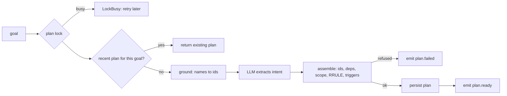
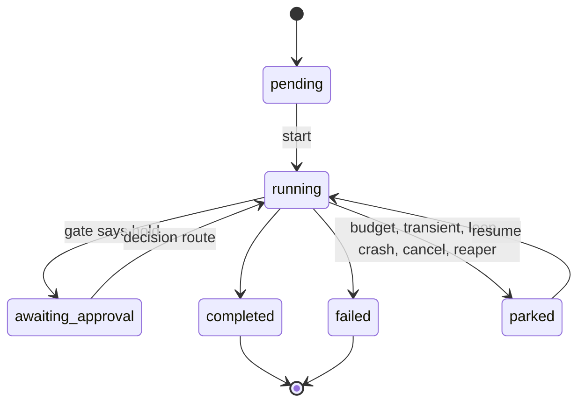

# autonomous-agent

A planner and executor that turn a plain-English goal into a durable plan, then run it with nobody watching: bounded, resumable and honest about what happened.

[](https://github.com/Tayyab-Bilal/autonomous-agent/actions/workflows/ci.yml)

> An open-source reference implementation of a durable, resumable autonomous planner and executor. All names and data are fictional.

## At a glance

**What it is.** A planner and an executor. The planner turns a plain-English goal into a stored plan, and the executor runs that plan with nobody watching, inside hard limits. Every LLM, grounding service and tool here is a scripted fake, so it all runs offline.

**What is built** (in this repo, working and tested)

- Ground the goal, let the LLM extract only structure, build the plan in code: `src/autonomous_agent/planner.py: Planner.create_plan()`
- Plan assembly: step ids, RRULE, triggers, scope ids from grounding only: `src/autonomous_agent/assembler.py: assemble()`, `schedule_to_rrule()`
- Refuses plans that cannot work, with a reason: `src/autonomous_agent/assembler.py: assemble()` (`RefusalReason`)
- Retry reuses the plan instead of a second LLM call: `src/autonomous_agent/planner.py: goal_hash()`, `src/autonomous_agent/store.py: plan_lock()`, `find_recent_plan()`
- Run state machine with atomic claims and fencing tokens: `src/autonomous_agent/runs.py: RunManager.transition()`, `claim_for_resume()`
- Bounded run loop (turn budget, write cap, retries, resume limit): `src/autonomous_agent/executor.py: Executor._drive()`, `ExecConfig`
- Loop guard, soft then hard: `src/autonomous_agent/loop_guard.py: LoopGuard.check()`
- Write ledger so a resumed write is a no-op: `src/autonomous_agent/executor.py: Executor._write()`, `idempotency_key()`
- Final status from stored step states, not from the agent: `src/autonomous_agent/executor.py: Executor._finalise()`
- Failure classification from the tool's response: `src/autonomous_agent/failures.py: classify_result()`
- Approval gate: allow, block or hold: `src/autonomous_agent/gate.py: ToolPolicyGate.check()`
- Event triggers with dedupe, ids-only context and a run cap: `src/autonomous_agent/triggers.py: TriggerHandler.handle_event()`
- Stranded runs parked by a reaper: `src/autonomous_agent/reaper.py: reap_stranded()`
- HTTP routes (202 plan, start, resume, decision, status, chat): `src/autonomous_agent/api.py: create_app()`

**What is not built / simplified here**

- No scheduler. A plan stores an RRULE and `next_runs()` computes dates, but nothing fires them.
- The LLM, grounder, step agent and chat orchestrator are fakes behind Protocols. No real adapters.
- Background tasks are in memory. There is no reaper loop; you call `reap_stranded` from your own timer.
- No auth on the routes, and no backoff on retries.
- Webhooks are a blocking POST with no retry queue.
- A crash between a write and its ledger insert can repeat that write once.
- Same-name entities are not handled: the fake grounder keys entities by name.

**How a goal becomes a plan and then a run**

1. A goal comes in. `POST /plans` (`api.py: create_plan`) answers 202 and plans in the background (`planner.py: create_plan_in_background()`). A plan lock and a 10-minute reuse check stop a retry from paying for the LLM twice (`planner.py: Planner.create_plan()`).
2. Grounding maps names in the goal to real ids (`grounding.py: Grounder.ground()`).
3. The LLM extracts only steps, branches, schedule, event and confidence. It never writes ids (`llm.py: PlanExtractor.extract()`).
4. Code assembles the plan: step ids, dependencies, scope ids from grounding, the RRULE and the trigger type. Bad plans are refused here (`assembler.py: assemble()`).
5. The plan is saved and `plan.ready` is emitted, or `plan.failed` if refused (`planner.py: Planner.create_plan()`, `store.py: save_plan()`).
6. A run is created `pending`, by hand or by an event (`runs.py: RunManager.create()`, `triggers.py: handle_event()`). Start claims it atomically and gives a fencing token (`runs.py: start()`, `executor.py: Executor.claim()`).
7. The executor loops. Each turn the agent proposes tool calls. Writes go through the gate, the ledger and the 150-write cap. The loop guard blocks repeats, soft on the 3rd identical call and hard on the 4th. The turn budget is 90 (`executor.py: _drive()`, `_call()`, `_write()`, `loop_guard.py: LoopGuard`). Final status comes from the stored step states (`executor.py: _finalise()`).
8. Anything unfinished is parked: budget used, repeated transient failure, loop, crash, cancel or a lost worker. A gate hold parks it as `awaiting_approval`. Resume claims the row again, and the ledger makes repeated writes no-ops (`runs.py: claim_for_resume()`, `executor.py: run_claimed()`, `reaper.py: reap_stranded()`, `POST /runs/{id}/decision`).

**Run it**

```bash
.venv/bin/pytest -q
```

Current result: 148 passed. No network, no API keys. `.venv/bin/python examples/demo.py` shows the same flow end to end.

## How each part works, one by one

Seven mechanisms make this repo safe to leave alone. Each one below says what goes wrong without it, how it works, and which tests prove it.

### 1. The model never writes an id or a schedule

- **Risk / problem:** If the LLM wrote ids, schedules or trigger names, one made-up value would become a real write at 9am on a Monday with nobody watching.
- **How it works:**
  - The goal is first matched against the real workspace, so names like "Apollo" turn into real ids before the model is even asked (`grounding.py: Grounder.ground()`).
  - The model only returns intent: step descriptions, the names it referred to, a schedule in words, an event name and how sure it is. It has no field where an id could go (`llm.py: ExtractedPlan`).
  - Plain code then builds the plan. It hands out the step ids itself, links the dependencies, and turns the schedule words into a standard recurrence rule. It also checks that rule and the timezone, so a malformed one is rejected (`assembler.py: assemble()`, `schedule_to_rrule()`).
  - A scope id is only accepted if grounding returned it for that name. A name the model invented has nothing to resolve to, so the plan is refused.
  - Event names go through a fixed map to trigger types the backend can really fire. A name with no match is dropped and listed in the plan, not guessed (`assembler.py: EVENT_MAP`).
- **Tests that prove it:** `tests/test_assembler.py`: `test_llm_cannot_inject_ids`, `test_scope_resolves_only_through_grounding`, `test_rrule_next_runs_respect_timezone_dst`, and 11 more in that file.

### 2. Plans that can never work are refused

- **Risk / problem:** A plan with no steps, a loop in its dependencies, or no way to start would be saved and then fail again and again, or worse, be guessed into something the user never asked for.
- **How it works:**
  - Assembly checks the plan before anything is saved. It refuses when the model says it needs clarification, when there are zero steps, when a dependency points nowhere or goes in a circle, when a name is not in grounding, and when there is neither a usable schedule nor a usable event (`assembler.py: assemble()`).
  - Every refusal carries a reason and a readable detail, so the person sees why and can fix the goal.
  - A refused plan is not stored and is not reused. The planner just emits a "plan failed" event with that reason (`planner.py: Planner.create_plan()`).
  - A bad schedule or an unmappable event is dropped without crashing. The plan only fails if nothing usable is left to start it.
- **Tests that prove it:** `tests/test_assembler.py`: `test_dependency_cycle_rejected`, `test_zero_steps_refused`, `test_all_triggers_dropped_refuses`, and 11 more in that file. `tests/test_planner.py`: `test_refusal_is_not_persisted_or_reused`.

### 3. A retried request does not pay for the LLM twice

- **Risk / problem:** Clients retry. Without protection, two identical requests would make two LLM calls and save two plans.
- **How it works:**
  - Each request gets a fingerprint from the user and the goal text, with case and spacing ignored. Reuse is per tenant and per user, never across users (`planner.py: goal_hash()`).
  - Planning for one fingerprint runs under a lock. The lock is a database row that must be inserted first, so only one request can hold it. The loser is told to retry later (`store.py: plan_lock()`).
  - The lock expires after five minutes, so a dead worker cannot block that goal forever. Release checks the owner, so a slow worker whose lock expired cannot free the next worker's lock.
  - Inside the lock, the planner first looks for a plan saved for the same fingerprint in the last ten minutes. If there is one, it returns it and never calls the LLM (`store.py: find_recent_plan()`).
  - The HTTP route answers at once with 202 and plans in the background, so a slow LLM cannot hit a gateway timeout. The result arrives as an event (`planner.py: create_plan_in_background()`).
- **Tests that prove it:** `tests/test_planner.py`: `test_retry_within_window_reuses_plan_and_does_not_call_llm_twice`, `test_slow_extractor_concurrent_requests_make_one_llm_call`, `test_expired_holder_does_not_release_the_new_holders_lock`, and 9 more in that file. `tests/test_api.py`: `test_post_plans_answers_202_at_once_and_plans_in_the_background`.

### 4. Only one worker owns a run: atomic claims, fencing tokens, the reaper

- **Risk / problem:** Two workers driving the same run would double every write. A worker that died, or was cut off, could wake up later and keep writing.
- **How it works:**
  - A run can only move along a fixed set of allowed steps, for example pending to running, or parked to running. Anything else raises an error (`runs.py: TRANSITIONS`).
  - Starting or resuming is one conditional database update: "set running, but only if the status is still what I expect". If two workers race, the database lets one through and the other gets a conflict (HTTP 409) (`runs.py: RunManager.claim_for_resume()`, `store.py: update_status()`).
  - Each successful claim bumps a counter on the run, and that number is the fencing token the worker carries. Every later heartbeat, step update and write checks that the token still matches, so a worker that lost the run is stopped before it writes (`store.py: check_fence()`).
  - The reaper looks for runs marked running whose last heartbeat is older than 60 minutes and parks them so they can be resumed. The age check is repeated inside the update itself, so a run that beat in the meantime is left alone (`reaper.py: reap_stranded()`).
  - On shutdown, a cancelled run parks itself before the cancel continues, so the park cannot be lost (`executor.py: Executor.run_claimed()`).
  - Simplification: nothing calls the reaper on a timer here. You call it from your own scheduler.
- **Tests that prove it:** `tests/test_runs.py`: `test_double_resume_one_wins_one_conflicts`, `test_fencing_token_cuts_off_a_replaced_worker`, `test_illegal_transition_raises`, and 6 more in that file. `tests/test_reaper.py`: `test_heartbeat_between_scan_and_update_is_not_reaped`, `test_stranded_running_run_is_parked`, and 3 more in that file. `tests/test_executor.py`: `test_reaped_worker_is_fenced_out_and_cannot_write`, `test_execute_refuses_a_run_someone_else_is_driving`. `tests/test_executor_failures.py`: `test_cancelled_run_is_parked_then_reraises`.

### 5. Hard limits and the loop guard

- **Risk / problem:** An unattended agent can burn money in a loop, make endless writes, or be resumed forever.
- **How it works:**
  - A run gets 90 turns per drive, then it parks and can be resumed. Transient failures are retried twice in the same turn, then the run parks (`executor.py: ExecConfig`, `Executor._drive()`).
  - Real writes are capped at 150 per run, and the count is stored on the run, so resuming does not reset it. Hitting the cap fails the run (`executor.py: Executor._write()`).
  - A run can be resumed at most three times over its life. Resumes after an approval do not count. And once a plan has had three failed runs, new runs for it are refused (`runs.py: RunManager.create()`).
  - The loop guard watches the agent's calls. It spots the same call giving the same result, a short cycle of calls going round, or a read tool being polled with no change. The third identical call is blocked and the agent gets a message asking it to try something else (`loop_guard.py: LoopGuard.check()`).
  - If the agent repeats the pattern anyway, the next try stops the run and parks it. If the agent does something new after a nudge, the warning resets. The same call with a changing result is never counted as a loop.
- **Tests that prove it:** `tests/test_loop_guard.py`: `test_identical_call_soft_on_third_hard_on_fourth`, `test_same_call_with_changing_results_is_not_a_loop`, `test_nudges_reset_after_a_genuinely_different_call`, and 8 more in that file. `tests/test_executor.py`: `test_step_budget_parks_resumable`, `test_write_cap_shared_across_resumes`, `test_lifetime_resume_limit_stops_endless_resuming`, `test_loop_guard_stops_a_looping_agent`. `tests/test_runs.py`: `test_plan_with_repeated_failed_runs_is_refused_with_a_readable_cause`.

### 6. The write ledger, resume, and an honest final status

- **Risk / problem:** After a crash or a pause, a resumed agent often repeats what it already did, and a write happens twice. An agent can also say "done" when it is not.
- **How it works:**
  - Before a write runs, the executor makes a fingerprint from the tool name and its arguments. Argument order does not matter, null values are ignored, and `1`, `"1"` and `1.0` count as the same number (`executor.py: idempotency_key()`).
  - If that fingerprint is already in the run's ledger, the stored result is returned and the tool is not called again. So a resumed agent that repeats a write gets a no-op (`executor.py: Executor._write()`).
  - The write count and the ledger row are saved together in one transaction, and only if this worker still holds the run (`store.py: record_write()`).
  - On every turn the agent is shown the plan again, with each step's state, its notes and which writes already ran. That stops it redoing a step against a new target (`executor.py: Executor._view()`).
  - The final status is worked out from the stored step states, not from the agent's words. Any failed step fails the run, unsettled steps park it, and a run where everything was blocked or nothing was done is failed (`executor.py: Executor._finalise()`).
  - A write the gate holds parks the run as awaiting approval. The approval covers only that exact call (`gate.py: ToolPolicyGate.check()`).
  - Simplification: if a crash lands between a write and its ledger row, that one write can repeat. This is at-least-once with de-duplication, not exactly-once.
- **Tests that prove it:** `tests/test_executor.py`: `test_resume_does_not_repeat_successful_write`, `test_equivalent_args_are_one_write`, `test_exception_never_completes`, and 26 more in that file. `tests/test_reconcile.py`: `test_executed_step_is_marked_already_executed_after_resume`. `tests/test_executor_failures.py`: `test_approval_is_for_the_held_call_only`, `test_gate_hold_parks_awaiting_approval`.

### 7. Event triggers carry ids only

- **Risk / problem:** An incoming event can hold user text, such as a task title that says "ignore previous instructions". If that reached the agent it would be a prompt injection. A duplicate or a flood of events could also start too many runs.
- **How it works:**
  - Only a fixed list of keys is copied into the run context, such as project id or task id. Even then a value must look like an id, not a sentence, so free text is dropped (`triggers.py: ALLOWED_CONTEXT_KEYS`, `_is_id()`).
  - The agent reads titles and descriptions through its own tools later, so they stay data and never become instructions.
  - A plan only matches if its trigger type fits the event and its scope ids overlap the ids in the event. An event for something out of scope is skipped quietly, not answered with an error the sender would retry forever (`triggers.py: TriggerHandler.handle_event()`).
  - Claiming the event id, checking the cap and creating the runs all happen in one transaction. Two events at once cannot both slip under the cap of three runs at a time, and a failure part-way rolls the claim back so a redelivery is still processed.
  - Only event-started runs count toward that cap, so a person starting a run by hand is never blocked by an event storm.
- **Tests that prove it:** `tests/test_triggers.py`: `test_free_text_stripped_from_event_context`, `test_concurrent_events_cannot_both_slip_under_the_cap`, `test_duplicate_event_ignored`, and 7 more in that file. `tests/test_api.py`: `test_event_run_cap_is_429`.

## The problem

"Every Monday, move overdue tasks in project Apollo to Blocked and create a review task." Someone
types that once. From then on it must run on a schedule, or when an event fires, at 3 a.m., against
a customer's real workspace, with nobody to catch a mistake.

That is hard in specific ways. A retry must not pay for the LLM twice or write twice. A run must not
loop or run away. A crash or a restart must not lose or repeat work. The agent must stay inside the
organisation's permissions, and it must report honestly: a crash is never "completed", and a policy
block is not a failure. And all of it must sit next to an interactive chat without risking it.

The setting here is a fictional "Acme Workspace" app (projects, tasks, documents, meetings). The LLM,
the grounding service, the step agent and the downstream tools are all scripted fakes, so everything
runs offline.

## What it does

- **Plans from a goal.** Ground the goal in real workspace names, let the LLM extract only structure
  and intent (steps, if/else branches, dependencies, confidence, unsupported parts), then assemble
  the plan in code: ids, RFC 5545 RRULEs and trigger types never come from the model
  (`planner.py`, `assembler.py`).
- **Refuses plans that can never work** with a readable cause: needs clarification, zero steps, no
  usable trigger, unknown scope, dependency cycle.
- **Plans in the background.** `POST /plans` answers 202 at once and emits `plan.ready` or
  `plan.failed`; a retried request reuses the in-flight or finished plan (`api.py`, `store.py`).
- **Runs unattended with hard bounds:** a 90-turn step budget, a 150-write cap shared across resumes,
  bounded retries, a lifetime resume limit, a plan-retry limit and a soft-then-hard loop guard
  (`executor.py`, `loop_guard.py`, `runs.py`).
- **Survives crashes.** Interrupted runs are marked `parked`; a write ledger makes a resumed write a
  no-op; the plan view replays notes and scratchpad and marks steps that already executed; a
  cancelled run parks itself before re-raising; a reaper parks stranded runs (`reconcile.py`,
  `reaper.py`).
- **Classifies failures from the tool's own response**, not only exceptions: whole-number status
  codes, write conflicts as transient, partial bulk creates never retried (`failures.py`).
- **Gates every write** with allow, block or hold. A hold parks the run `awaiting_approval` and a
  decision route resumes it (`gate.py`).
- **Reacts to events** with de-duplication, ids-only context (free text is dropped), fail-closed
  scoping, and a cap on concurrent event-triggered runs (`triggers.py`, `trigger_catalog.json`).
- **Reports as CloudEvents**, optionally as HMAC-signed webhooks with an idempotency key, never
  blocking a database write (`events.py`, `webhooks.py`).
- **Keeps chat structurally separate:** the interactive route's request model has no autonomous
  fields, and its module cannot reach the executor or gate (`chat.py`).

## Quickstart

```bash
uv venv .venv && uv pip install -e ".[dev]"
.venv/bin/python examples/demo.py
.venv/bin/pytest -q
```

Requires Python 3.11+. No network, no API keys. The demo plans the Apollo goal, shows the next
three London runs, hits a transient failure and resumes without a duplicate write, stops a looping
agent, holds a write for approval, and prints the events. An excerpt of its real output:

```text
=== 1. Plan: ground, extract (fake LLM), assemble
plan plan-adb7a1ae: 3 steps, scope ids ['p-1']
RRULE FREQ=WEEKLY;BYDAY=MO;BYHOUR=9;BYMINUTE=0  TZID=Europe/London
  next run Mon 23 Mar 2026 09:00 GMT  (UTC 09:00)
  next run Mon 30 Mar 2026 09:00 BST  (UTC 08:00)

=== 2. Run: complete a step, hit a transient error, park resumable
status: parked (transient failure after 3 attempts: 503 from task service)

=== 3. Resume (execute claims it atomically): the ledger no-ops the repeated write
status: completed (all steps settled)
move_task really executed 1x, create_task 1x, writes counted 2

=== 4. A looping agent is stopped by the loop guard
status: parked (loop detected: the same call returned the same result 2 times already)
turns the agent got to use: 4 of 8

=== 5. A write that needs approval parks the run; a decision resumes it
status: awaiting_approval (policy: 'create_task' needs approval)
after approval: completed; create_task really executed 2x in total
```

## Usage guide

The short version. [docs/usage.md](docs/usage.md) has the fuller walkthrough and
[docs/api.md](docs/api.md) lists every public name and the HTTP routes. These snippets run as
written (`tests/test_docs.py`); they use top-level `await`, so paste them into `python -m asyncio`.

Create a plan:

```python
from datetime import UTC, datetime

from autonomous_agent.clock import ManualClock
from autonomous_agent.events import ListEventSink
from autonomous_agent.grounding import EntityRef, FakeGrounder
from autonomous_agent.llm import ExtractedPlan, FakeExtractor, ScheduleIntent, StepIntent
from autonomous_agent.planner import Planner
from autonomous_agent.runs import RunManager
from autonomous_agent.store import Store

clock = ManualClock(datetime(2026, 3, 20, 10, 0, tzinfo=UTC))
sink, store = ListEventSink(), Store(clock=clock)
runs = RunManager(store, sink)
llm_says = ExtractedPlan(  # names and intent only; the model never emits ids
    steps=[StepIntent(key="move", instruction="Move overdue tasks to Blocked", scope_refs=["Apollo"])],
    schedule=ScheduleIntent(frequency="weekly", weekdays=["MO"], hour=9, timezone="Europe/London"))
planner = Planner(store, FakeGrounder([EntityRef(id="p-1", kind="project", name="Apollo")]),
                  FakeExtractor([llm_says]), sink)

result = await planner.create_plan("Every Monday 9am, move overdue Apollo tasks to Blocked", "acme", "u-1")
assert result.plan.steps[0].id == "step-1" and result.plan.steps[0].scope_ids == ["p-1"]
```

Run it with an agent. The agent proposes tool calls; the executor enforces the bounds:

```python
from autonomous_agent.executor import AgentTurn, Executor, FakeStepAgent, Tool, ToolCall

moved = []


async def move_task(args):
    moved.append(args)
    return {"moved": args["task"]}


executor = Executor(store, runs, {"move_task": Tool(move_task, write=True)})
run_id = runs.create(result.plan_id, "acme", {"project_id": "p-1"})
agent = FakeStepAgent([AgentTurn(done=True, calls=[
    ToolCall(name="move_task", args={"task": "task-7"}, step_id="step-1"),
    ToolCall(name="mark_step_complete", args={"step_id": "step-1"}),
])])
assert await executor.execute(run_id, agent) == "completed" and len(moved) == 1
```

Gate a write so a person must approve it:

```python
from autonomous_agent.gate import ToolPolicyGate

gated = Executor(store, runs, {"move_task": Tool(move_task, write=True)},
                 gate=ToolPolicyGate(needs_approval=frozenset({"move_task"})))
run_id = runs.create(result.plan_id, "acme", {})
move = ToolCall(name="move_task", args={"task": "task-9"}, step_id="step-1")
assert await gated.execute(run_id, FakeStepAgent([AgentTurn(calls=[move])])) == "awaiting_approval"
token = gated.claim(run_id, ("awaiting_approval",))  # POST /runs/{id}/decision does this
store.decide_held(run_id, approved=True)
done = FakeStepAgent([AgentTurn(done=True, calls=[
    move, ToolCall(name="mark_step_complete", args={"step_id": "step-1"})])])
assert await gated.run_claimed(run_id, token, done) == "completed"
```

## How it works

Planner pipeline (`planner.py`):



Run state machine (`runs.py`; every arrow emits a CloudEvent):



The main flow:

1. `POST /plans` returns 202 and spawns a task that runs the planner pipeline. The result is a
   `plan.ready` or `plan.failed` event.
2. A run is created `pending`, by hand (`POST /plans/{id}/runs`) or by an inbound event
   (`POST /events`, which de-duplicates, scopes and caps).
3. `POST /runs/{id}/start` claims the run with one conditional `UPDATE`. The loser gets 409. The
   winner gets a fencing token and a background task drives the run.
4. Each turn the executor rebuilds a `RunView` from the database (steps, notes, scratchpad, branches,
   already-executed writes), asks the agent for tool calls, and runs them: reads directly, writes
   through the gate, the ledger and the write cap, reconciliation tools through `reconcile.py`.
5. Every tool result is classified (`failures.py`): transient is retried a bounded number of times
   then the run parks; terminal fails the step.
6. When the agent says it is done, the executor computes the final status from the stored step
   states. The agent's claim is never the source of truth.
7. A hold from the gate parks the run `awaiting_approval`; `POST /runs/{id}/decision` claims it,
   records the decision for the held call, and resumes it.
8. If the worker dies, the reaper marks the run `parked`; if the app shuts down, each
   cancelled run parks itself before the cancellation continues.

## Design decisions

1. **The model proposes, code decides.** The LLM returns names and intent; `assembler.py` builds ids,
   RRULEs and trigger types, and accepts a scope id only if grounding returned it. *Rejected:* letting
   the model write ids or RRULE strings, where one hallucination becomes a bad write on Monday at 9am.
2. **Refuse, don't best-effort.** A plan that can never succeed (zero steps, needs clarification, no
   usable trigger) is refused with a readable cause. *Rejected:* retrying forever, or guessing.
3. **Retries reuse, never repay.** A per-request lock plus a 10-minute reuse window means a retried
   request gets the in-flight or finished plan. *Rejected:* an LLM call per request.
4. **Planning is asynchronous.** The route answers 202 and reports by event, because a slow LLM can hit a
   typical gateway timeout. *Rejected:* a long synchronous request.
5. **Status comes from stored step states.** A crashed turn is not completed, blocked is not failed,
   a terminal write failure stops the run in code, and a settled step cannot be flipped by the agent.
   *Rejected:* trusting the agent's "done".
6. **Every run is bounded.** Turn budget, a write cap shared across resumes, bounded retries, a
   lifetime resume limit, a plan-retry limit and a loop guard. *Rejected:* one big budget, which an
   agent could burn on a loop.
7. **Loop guard: soft, then hard.** The 3rd identical call (same arguments, same result) is blocked
   with a nudge; the 4th stops the run. Cycles and polling follow the same shape. *Rejected:* a hard
   stop on the first repeat (too jumpy) or none (burns the whole budget).
8. **A write ledger, not checkpoints.** A successful write is recorded under a hash of tool and
   canonical args, so a resumed agent that repeats it gets the stored result. At-least-once with
   de-duplication, not exactly-once. *Rejected:* trusting the agent to remember.
9. **The plan view replays state.** Real run data showed step notes were written in nearly every run but
   never read back. The view now replays scratchpad and notes, and marks steps whose writes already
   ran. That marker fixed an approval loop where a resumed agent redid an approved step on a
   different target. *Rejected:* a bare list of step statuses.
10. **Classify from the response.** Real tools return errors instead of raising. Status codes match as
    whole numbers (task 1404 is not a 404), write conflicts (409, optimistic concurrency) are
    transient, and a partial bulk create is never retried. *Rejected:* substring matching and
    exception-only classification.
11. **Chat isolation is structural.** The interactive request model has no autonomous fields and
    forbids extras, and `chat.py` imports nothing from the executor, gate or store. *Rejected:* an
    `if autonomous` flag on a shared model, which one missing check turns into an escalation path.
12. **Ids-only event context.** Event payloads pass a typed allow-list, so a task title like "ignore
    previous instructions" never reaches the agent. Out-of-scope events are skipped quietly
    (fail closed), not answered with a 4xx the sender would retry forever.
13. **Only event-triggered runs count toward the concurrency cap.** The cap is a storm guard; a person
    starting a run by hand must not be blocked by it.
14. **Park before re-raising on cancellation.** Shutdown cancels background runs; catching
    `CancelledError`, parking synchronously, then re-raising means the write cannot be lost.
15. **Webhooks are best-effort.** Signed with HMAC-SHA256 over the body plus an `Idempotency-Key`;
    delivery errors are logged and never block the database write.
16. **A database row is the unit of durability, not a graph checkpoint.** LangGraph's native
    `interrupt()` was considered. The executor is a tree of independently invoked agents without checkpointers, so a
    pause deep inside one cannot be resumed. It is documented so no
    one rediscovers it. Step states plus the ledger resume by replaying the agent; "resume" is one
    atomic claim on the row. The cost: resumption re-runs agent turns rather than continuing mid-thought.

Also included: fencing tokens (a reaped worker is cut off
from the run it lost), the lifetime resume limit, and the canonicalised ledger key.

## Testing

```bash
.venv/bin/pytest -q
```

No network and no API keys; the suite finishes in under 10 seconds. Tests are named for the rule
they protect, and the docs examples are executed too.

| Invariant | Test (file) |
| --- | --- |
| The LLM cannot inject ids | `test_llm_cannot_inject_ids` (assembler) |
| Retries reuse the plan; no second LLM call | `test_retry_within_window_reuses_plan_and_does_not_call_llm_twice` (planner) |
| `POST /plans` answers 202 before the plan exists | `test_post_plans_answers_202_at_once_and_plans_in_the_background` (api) |
| Exactly one of two racing resumes wins | `test_double_resume_one_wins_one_conflicts` (runs) |
| Lost claims are 409, the event cap is 429 | `test_starting_twice_is_409`, `test_event_run_cap_is_429` (api) |
| Chat cannot reach the executor or gate | `test_chat_path_cannot_construct_the_executor_or_the_gate`, `test_chat_route_rejects_every_autonomous_field` (api) |
| A resume does not repeat a write | `test_resume_does_not_repeat_successful_write` (executor) |
| The plan view replays notes, scratchpad and the executed marker | `test_scratchpad_and_notes_are_replayed_to_the_resumed_agent`, `test_executed_step_is_marked_already_executed_after_resume` (reconcile) |
| `rewrite_plan` is bounded and logged | `test_rewrite_plan_is_bounded`, `test_rewrite_plan_changes_a_pending_step_only_for_this_run` (reconcile) |
| The untaken branch is skipped | `test_choose_branch_skips_the_side_not_taken` (reconcile) |
| Status codes are whole numbers; conflicts transient; partial bulk never retried | `test_http_codes_read_as_integers`, `test_write_conflict_is_transient`, `test_partial_bulk_create_is_never_retried` (failures) |
| A cancelled run parks, then re-raises | `test_cancelled_run_is_parked_then_reraises` (executor_failures) |
| A hold parks `awaiting_approval`; approval covers only the held call | `test_gate_hold_parks_awaiting_approval`, `test_approval_is_for_the_held_call_only` (executor_failures) |
| Soft on the 3rd identical call, hard on the 4th | `test_identical_call_soft_on_third_hard_on_fourth` (loop_guard) |
| A plan that failed N times gets no more runs | `test_plan_with_repeated_failed_runs_is_refused_with_a_readable_cause` (runs) |
| Webhooks are signed, carry an idempotency key, and never block the write | `test_body_is_signed_with_the_shared_secret_and_carries_an_idempotency_key`, `test_delivery_failure_is_logged_and_never_blocks_the_database_write` (webhooks) |
| The trigger map is pinned to the catalog | `test_every_mapped_trigger_exists_in_the_catalog`, `test_every_catalog_type_is_mapped_or_explicitly_excluded` (catalog) |
| Only event runs count toward the cap | `test_concurrent_run_cap_counts_event_triggered_runs_only` (triggers) |
| Free text never reaches the run context | `test_free_text_stripped_from_event_context` (triggers) |
| A crash is never "completed" | `test_exception_never_completes` (executor) |
| Doc snippets run | `test_python_blocks_in_the_docs_run` (docs) |

## Limits and known trade-offs

- **Same-name targets.** Entities that share a name need explicit target rules (a "highest id means
  most recent" guess can pick the wrong one). That guard is not implemented here: the fake grounder keys entities by name.
- **Triggers.** 20 invented types. Two catalog entries are
  deliberately excluded, with reasons, in `trigger_catalog.json`.
- **No scheduler.** A plan stores an RRULE and `next_runs` computes occurrences, but nothing fires them.
- **Start is guarded by the atomic claim,** not a per-plan advisory lock.
- **Background tasks are in memory.** A hard crash loses the task, not the run: the reaper parks it
  as `parked`. There is no reaper loop in the app; call `reap_stranded` from your own timer.
- **Webhook delivery is a blocking POST** with no retry queue; a real deployment would queue and retry.
- **No auth on the routes.** `tenant` comes from the request body; identity would come from the gateway in a real deployment.
- **Retries have no backoff,** and a crash between a write and its ledger insert can repeat that write
  once. Pass the idempotency key downstream to close the gap.
- **The ledger is per run and unordered.** A, B, A within one run suppresses the third write, so tools
  must treat "same name and args" as "same write", and must not give `null` or a numeric string a
  meaning that differs from absent or the number.
- **`rewrite_plan` re-words pending steps only.** It cannot add steps, ids or tools.
- **No dangling tool-call repair on a hard stop:** there is no message history here.
- **Real adapters are not included:** the discovery-based grounder, the structured-output extractor and
  the chat orchestrator are fakes behind Protocols.
- **Trigger lookup scans** a tenant's plans in Python; a real store would index plans by trigger type.

## Project layout

```
src/autonomous_agent/
  api.py            FastAPI routes: plans, runs, events, status, chat
  chat.py           interactive path: request model with no autonomous fields, imports nothing autonomous
  planner.py        the planning pipeline, with a never-raising background form
  assembler.py      pure plan assembly: ids, scope, RRULE, triggers, branches, EVENT_MAP
  trigger_catalog.json  the trigger types the backend can fire
  llm.py, grounding.py  extractor / grounder Protocols, intent models, scripted fakes
  runs.py           run state machine, atomic claims, plan-retry limit
  executor.py       bounded run loop, write path, ledger, finalisation
  reconcile.py      reconciliation tools: settle, notes, scratchpad, rewrite_plan, choose_branch
  failures.py       transient vs terminal, read from tool responses
  gate.py           WriteGate, allow / block / hold
  loop_guard.py     identical repeats, cycles, polling; soft then hard
  triggers.py       inbound events to runs: dedupe, ids-only, scope, event-run cap
  events.py         CloudEvents and best-effort emission
  webhooks.py       HMAC-signed webhook sink
  reaper.py         parks stranded running runs
  store.py          SQLite: plans, runs, steps, ledger, notes, scratchpad, approvals, locks
  models.py, clock.py   shared shapes; injectable clock
tests/              unit and API tests, plus the docs-example runner
examples/demo.py    the end-to-end walkthrough above
docs/usage.md       fuller usage guide
docs/api.md         public API and HTTP routes
```

## License

MIT
